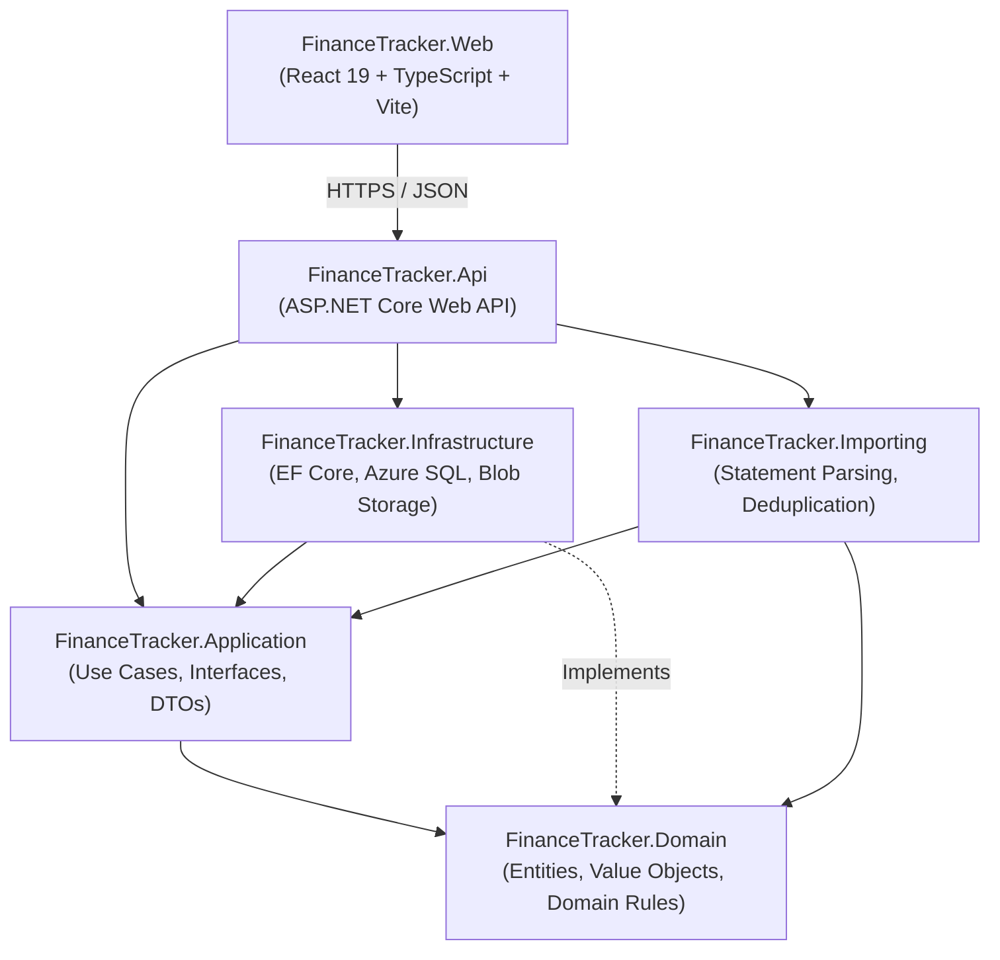

# FinanceTracker

FinanceTracker is a private household finance tracker designed to consolidate financial information from user-uploaded statements and provide an accurate view of assets, liabilities, transactions, investments, and net worth.

---

## Target Architecture

FinanceTracker is structured as a **modular monolith** with clear separation of concerns across layers:



### Layer Responsibilities

| Layer | Project | Purpose | Dependencies |
|-------|---------|---------|--------------|
| **Domain** | `FinanceTracker.Domain` | Core entities, value objects (`Money`), domain invariants, enums | None |
| **Application** | `FinanceTracker.Application` | Business use cases, CQRS commands/queries, application interfaces, DTOs | Domain |
| **Infrastructure** | `FinanceTracker.Infrastructure` | EF Core persistence, Azure SQL, Blob Storage service, Key Vault | Application |
| **Importing** | `FinanceTracker.Importing` | Statement parsers (CSV/OFX), content hashing, deduplication logic | Domain, Application |
| **API** | `FinanceTracker.Api` | HTTP controllers, authentication, middleware, dependency injection | Application, Infrastructure, Importing |
| **Web** | `FinanceTracker.Web` | SPA client with React 19, TypeScript, Vite | Independent (communicates via HTTP) |

---

## Technology Stack

- **Backend**: C# 13 / .NET 10 (LTS)
- **Frontend**: React 19, TypeScript 5.x, Vite
- **Persistence**: Entity Framework Core 10, Azure SQL Database
- **File Storage**: Private Azure Blob Storage
- **Infrastructure**: Azure Bicep (modular, parameterized for Dev & Prod)
- **CI/CD**: GitHub Actions with Azure OIDC federation
- **Testing**: xUnit, FluentAssertions, NSubstitute, WebApplicationFactory, Vitest

---

## Financial Correctness Rules

1. **No Floating-Point Money**: All monetary amounts use the `Money` value object backed by `decimal` arithmetic and mapped to `decimal(19,4)` in SQL.
2. **Banker's Rounding**: Rounding explicitly uses `MidpointRounding.ToEven`.
3. **Explicit Currencies**: All transactions and accounts declare ISO 4217 3-letter currency codes. Cross-currency arithmetic is disallowed without explicit conversion.
4. **Import Idempotency**: Imports use SHA-256 content hashing (`AccountId + Date + Description + Amount + Currency`) to prevent duplicate transactions. Original statements are preserved in private Blob Storage.
5. **Synthetic Test Data Only**: Never commit or test with real household statements or live financial records.

---

## Prerequisites

- [.NET 10 SDK](https://dotnet.microsoft.com/) (`10.0.x`)
- [Node.js 24 LTS](https://nodejs.org/) (`v24.x`)
- [npm](https://www.npmjs.com/) (`11.x`+)
- [Azure CLI](https://learn.microsoft.com/en-us/cli/azure/install-azure-cli) (optional, for Bicep validation)

---

## Local Development Quickstart

### 1. Build and Run the Backend

```bash
# Restore dependencies
dotnet restore FinanceTracker.slnx

# Build the solution
dotnet build FinanceTracker.slnx

# Run all backend tests
dotnet test FinanceTracker.slnx

# Launch the API host (defaults to https://localhost:7001, in-memory DB in dev)
dotnet run --project src/FinanceTracker.Api/FinanceTracker.Api.csproj
```

Health check is available at: `GET https://localhost:7001/health`
Swagger documentation is available at: `https://localhost:7001/swagger` (in Development mode)

### 2. Build and Run the Frontend

```bash
cd src/FinanceTracker.Web

# Install dependencies
npm install

# Run frontend tests
npm test

# Run linter
npm run lint

# Start development server (with API proxy to https://localhost:7001)
npm run dev
```

The web application will be accessible at: `http://localhost:3000`

---

## Infrastructure as Code (Bicep)

All infrastructure is defined as code in `infra/` using Azure Bicep modules:

- `infra/main.bicep`: Orchestrator template deploying identity, SQL, storage, and app service.
- `infra/modules/`: Reusable Bicep modules (`sql.bicep`, `storage.bicep`, `app-service.bicep`, `identity.bicep`).
- `infra/parameters/`: Environment configurations (`dev.bicepparam`, `prod.bicepparam`).
- `infra/bootstrap/README.md`: One-time setup instructions (OIDC federation, resource group creation).

> [!IMPORTANT]
> Live Azure resources must never be modified or deployed autonomously. All deployments require explicit approval and run through reviewed GitHub Actions automation.

To validate Bicep templates locally:

```bash
az bicep lint --file infra/main.bicep
az bicep build --file infra/main.bicep
```

---

## CI/CD Workflows

- `.github/workflows/ci.yml`: Runs on pull requests and pushes to `main`. Builds and executes all backend tests (.NET 10) and frontend tests/linting (Node 24).
- `.github/workflows/infra-validate.yml`: Runs on changes to `infra/**`. Lints and compiles Bicep templates.

---

## Project Backlog & Next Steps

See [`docs/backlog/p0-essential.md`](file:///c:/Hardik/FinanceTracker/docs/backlog/p0-essential.md) for the MVP feature roadmap.

**Recommended First Vertical Slice**: **Account Management (CRUD)**
- Establishes the complete end-to-end stack: Domain `Account` entity -> Application commands/queries -> EF Core persistence -> API endpoints -> React UI.
