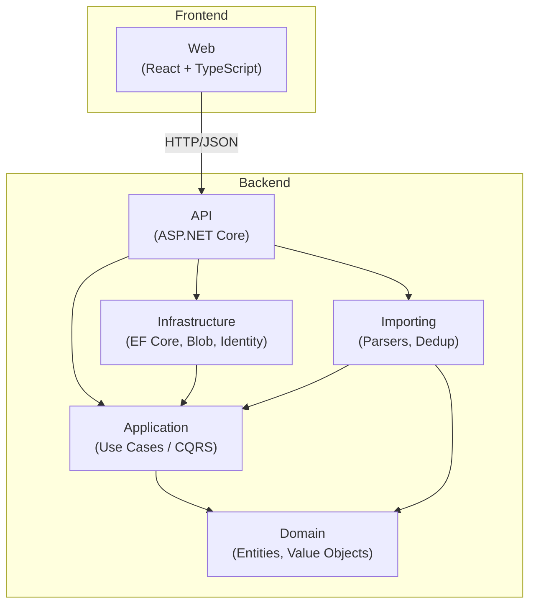

# FinanceTracker — Architecture

> **FinanceTracker** is a private household finance tracker that consolidates bank statements,
> tracks transactions, and provides a clear picture of spending, saving, and net worth
> for a small household (1-3 users).

---

## 1. Guiding Principles

| Principle | Implication |
|---|---|
| **Simplicity first** | Modular monolith, single deployment unit, no micro-services. |
| **Privacy by default** | Self-hosted data, no third-party analytics, private blob storage. |
| **Correctness over speed** | Banker's rounding, `decimal(19,4)` precision, idempotent imports. |
| **Grow when it hurts** | Start minimal; add capability (e.g. auto-categorisation) only when the manual path is validated. |

---

## 2. High-Level Architecture



---

## 3. Layer Responsibilities

### Domain

The innermost layer. Contains entities, value objects (e.g. `Money`), enums, and
domain rules. **Has zero project references** — it depends on nothing.

### Application

Defines use-case interfaces, DTOs, validation rules, and service contracts.
References **Domain** only.

### Infrastructure

Implements persistence (EF Core), blob storage, identity, and any external
integrations. References **Application** (to implement its interfaces).

### Importing

Owns file-parsing logic (CSV, OFX, PDF) and import-deduplication.
References **Application** and **Domain** (needs value objects for parsed data and
service contracts for persistence).

### API

The HTTP boundary. Hosts controllers/minimal-API endpoints, middleware,
authentication configuration, and DI composition root.
References **Application**, **Infrastructure**, and **Importing**.

### Web

Standalone React + TypeScript SPA. Communicates with the API exclusively over
HTTP/JSON. Has no .NET project reference.

### Dependency Rules

> [!IMPORTANT]
> Dependencies point **inward** — outer layers depend on inner layers, never the reverse.
> Domain must remain free of framework references.

| Layer | May Reference |
|---|---|
| Domain | *(none)* |
| Application | Domain |
| Infrastructure | Application |
| Importing | Application, Domain |
| API | Application, Infrastructure, Importing |
| Web | *(standalone — HTTP only)* |

---

## 4. Technology Stack

| Component | Technology | Version |
|---|---|---|
| Runtime | .NET | 10 |
| Web framework | ASP.NET Core | 10 |
| ORM | Entity Framework Core | 10 |
| Database | Azure SQL | — |
| Blob storage | Azure Blob Storage | — |
| Frontend framework | React | 19 |
| Frontend language | TypeScript | 5.x |
| Build tool | Vite | 6 |
| IaC | Azure Bicep | — |
| CI/CD | GitHub Actions | — |
| Testing | xUnit | latest |

---

## 5. Module Boundaries & Growth

The modular monolith is organised by **layer**, not by feature-slice, at this stage.
As the codebase grows, each layer can be split into feature folders internally
(e.g. `Application/Accounts/`, `Application/Imports/`).

If a module grows complex enough to warrant independent deployment, the existing
interface boundaries in `Application` make extraction into a separate service
straightforward — but that decision is deferred until the pain is real.

---

## 6. ADR Format Template

```markdown
# ADR-NNN: <Title>

**Status:** Proposed | Decided | Superseded by ADR-XXX
**Date:** YYYY-MM-DD
**Deciders:** <names or roles>

## Context
<What is the issue we are deciding on?>

## Decision
<What did we decide?>

## Consequences
### Positive
- …
### Negative
- …
### Risks
- …
```

---

## 7. Architecture Decision Records

### ADR-001: Modular Monolith

**Status:** Decided
**Date:** 2025-06-15

#### Context

FinanceTracker serves a single household (1-3 users). The operational overhead of
micro-services — separate deployments, service discovery, distributed tracing — is
disproportionate to the problem size.

#### Decision

Adopt a **modular monolith**: one deployable unit with clear layer and module
boundaries enforced by project references.

#### Consequences

| | |
|---|---|
| **Positive** | Single deployment unit, simpler CI/CD, easier local development, lower Azure cost. |
| **Negative** | All modules share the same process; a badly behaved module can affect the whole app. |
| **Risks** | If the project scope ever grows beyond household scale, extraction to services will require effort (mitigated by clean interface boundaries). |

---

### ADR-002: Decimal Monetary Precision

**Status:** Decided
**Date:** 2025-06-15

#### Context

Financial amounts require exact decimal arithmetic. IEEE 754 floating-point
(`float`/`double`) introduces rounding errors that are unacceptable for money.

#### Decision

- Use `decimal(19,4)` in SQL and `decimal` in C# for all monetary values.
- Apply **banker's rounding** (`MidpointRounding.ToEven`) everywhere.
- Encapsulate amount + currency in a `Money` value object in the Domain layer.

#### Consequences

| | |
|---|---|
| **Positive** | Exact cent-level arithmetic; no silent rounding surprises; currency awareness from day one. |
| **Negative** | `decimal` arithmetic is slower than `double` — irrelevant at household scale. |
| **Risks** | Multi-currency support (exchange rates, conversion) is deferred; the `Money` VO is ready for it but no conversion logic exists yet. |

---

### ADR-003: Import Idempotency

**Status:** Decided
**Date:** 2025-06-15

#### Context

Users will re-upload the same statement or overlapping statements. Duplicate
transactions must be detected and rejected without manual intervention.

#### Decision

- Compute a **SHA-256 content hash** from `(AccountId + Date + Description + Amount + CurrencyCode)` for each parsed row.
- Store the hash on the `Transaction` entity; enforce uniqueness per account.
- Preserve original uploaded files in blob storage for audit.

#### Consequences

| | |
|---|---|
| **Positive** | Re-uploading the same file is safe; overlapping date ranges across files are handled automatically. |
| **Negative** | Genuinely identical transactions on the same day (e.g. two $5.00 coffee purchases at the same place) will be treated as duplicates. A future enhancement can add a sequence/counter field. |
| **Risks** | Hash collisions are astronomically unlikely with SHA-256 but should be monitored. |

---

### ADR-004: Authentication Strategy

**Status:** Decided
**Date:** 2025-06-15

#### Context

The app needs user authentication but serves only 1-3 household members.
Enterprise-grade identity providers (Azure AD B2C, Auth0) add cost and complexity
that are not justified.

#### Decision

Use **ASP.NET Core Identity** with the built-in user store (EF Core-backed).
Support cookie authentication for the SPA and optionally JWT for API-only access.

#### Consequences

| | |
|---|---|
| **Positive** | Zero additional cost; well-documented; built into the framework; simple local development. |
| **Negative** | No social login or MFA out of the box (can be added later). |
| **Risks** | If the user base ever grows beyond household scale, migration to an external IdP will require effort. |

---

### ADR-005: Blob Storage Access

**Status:** Decided
**Date:** 2025-06-15

#### Context

Uploaded bank statements contain sensitive financial data. Direct browser access to
blob storage (via SAS URLs or public containers) increases the attack surface.

#### Decision

- All blob containers are **private** — no public access, no anonymous access.
- The API mediates every blob read/write; no SAS URLs are exposed to end users.
- Production uses **managed identity** to authenticate to Azure Blob Storage.

#### Consequences

| | |
|---|---|
| **Positive** | Statements are never directly accessible from the internet; access control is centralised in the API. |
| **Negative** | Every file download proxies through the API, adding latency and CPU cost (negligible at household scale). |
| **Risks** | If large files (e.g. scanned PDFs) need streaming, the proxy approach may need buffering optimisation. |
