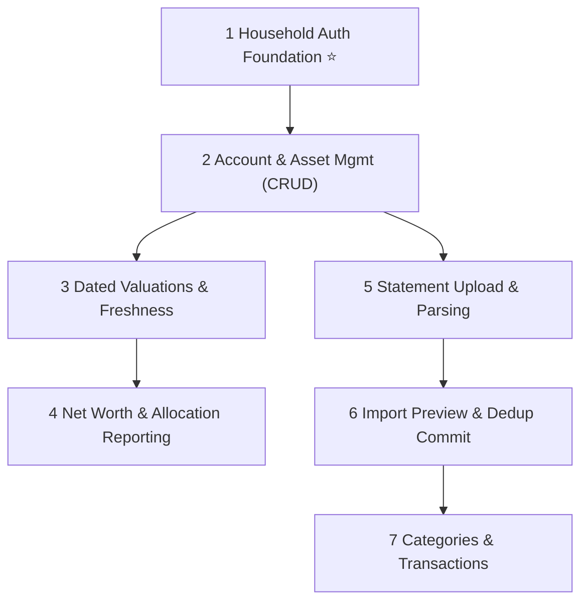

# FinanceTracker — P0 Essential Backlog (Reconciled MVP)

> These are the **must-have** features for a production-ready Minimum Viable Product for a two-user household.
> Items are ordered by architectural dependency and implementation sequence.

---

## 1. Household Security & Authorization Foundation ⭐ *Foundational Slice*

> [!IMPORTANT]
> Authentication and server-side household authorization must precede financial records.
> Every protected operation must enforce access on the server; the frontend is never a security boundary.

**Description:** Provider-independent authentication context and household authorization handler. Establishes user identification, active household tenancy, and role-based / ownership-based access control.

**Acceptance Criteria:**
- [x] Server extracts authenticated user ID and household membership claims from security token / session cookie (`ICurrentUser`, `IHouseholdContext`).
- [x] Requests without valid authentication return `401 Unauthorized` on protected endpoints.
- [x] Requests attempting to access data outside the user's household return `403 Forbidden`.
- [x] Local development and test authentication scheme enables seamless automated and manual testing without external cloud identity provider dependencies.
- [x] ASP.NET Core Identity with secure HttpOnly cookies, account lockout (5 attempts / 15 min), and environment gating (DevAuth completely excluded in Production).

**Layers:** Application · Infrastructure · API · Tests  
**Complexity:** **M**  
**Status:** **Completed & Verified (16 API & Auth Security integration tests)**

---

## 2. Account & Asset Management (CRUD)

**Description:** Manage financial accounts and wealth holdings across all supported asset types (Bank Checking, Savings, Credit Card, Investment, Fixed Deposit, EPF, PPF, NPS, Loan, Other) with explicit Joint or Individual ownership.

**Acceptance Criteria:**
- [x] User can create, view, edit, and soft-deactivate financial accounts.
- [x] Supports all core asset/liability categories: Checking, Savings, CreditCard, Investment, FixedDeposit, Epf, Ppf, Nps, Loan, Other.
- [x] Individual accounts require a valid `OwnerUserId`; Joint accounts are shared across the household.
- [x] Server-side validation enforces 3-letter ISO 4217 currency codes, non-empty names, and tenancy.
- [x] Joint accounts can be modified by any household member; individual accounts can only be modified by their owner or household admin.
- [x] React UI provides responsive account listing, creation/edit modals, ownership badges, and active/inactive filters.

**Layers:** Domain · Application · Infrastructure · API · Web  
**Complexity:** **S**  
**Status:** **Completed & Verified (65 Domain tests + 8 Application tests + 8 API tests)**

---

## 3. Dated Valuations & Asset Freshness

**Description:** Record historical and current dated valuations for accounts and illiquid/retirement assets (e.g. EPF passbook balance, PPF credit, NPS NAV valuation, FD maturity value, bank closing balance).

**Acceptance Criteria:**
- [x] User can record a dated valuation (`ValuationDate`, `Amount`, `CurrencyCode`, `SourceType`, `Notes`, `SourceReference`).
- [x] Valuation amount uses exact decimal arithmetic and enforces currency match with account.
- [x] User can edit valuations with complete audit trail (`UpdatedByUserId`, `UpdatedAt`).
- [x] View valuation history for an account sorted chronologically in UI and API.
- [x] System identifies latest valuation and computes "staleness" (configurable threshold, default >90 days).
- [x] Duplicate-date valuations resolve deterministically using creation timestamp ordering.
- [x] Explain data coverage and valuation dates explicitly in the UI rather than assuming stale figures are current.

**Layers:** Domain · Application · Infrastructure · API · Web  
**Complexity:** **M**  
**Status:** **Completed & Verified (Domain tests + Application tests + API tests)**

---

## 4. Household & Individual Net Worth Reporting

**Description:** Calculate household consolidated net worth and permitted individual net worth breakdowns, categorizing assets vs liabilities and detailing asset allocation.

**Acceptance Criteria:**
- [x] Consolidated household net worth = Total Assets (Joint + Member 1 + Member 2) − Total Liabilities, strictly partitioned per currency (no silent conversion/mixing of currencies).
- [x] Permitted individual net worth = Individual's personal accounts + 50% of joint accounts.
- [x] Asset allocation breakdown per currency (by AccountType).
- [x] Explicitly disclose valuation freshness/date and flag missing or stale valuations for every contributing balance.
- [x] Historical comparison between two dates calculating absolute delta and percentage change per currency.

**Layers:** Domain · Application · API · Web  
**Complexity:** **M**  
**Status:** **Completed, Audited & Verified (116 backend tests + 4 frontend tests; see `docs/reviews/security-financial-readiness.md`)**

---

## 5. Statement Upload & Isolated File Parsing

**Description:** Secure statement upload to private Azure Blob Storage and isolated parsing of financial statement files (CSV).

**Acceptance Criteria:**
- [ ] Validates MIME type, file extension (`.csv`, `.ofx`, `.pdf`), file size limit (10 MB), and file content.
- [ ] File stored in private blob storage; original file name preserved in audit metadata.
- [ ] Isolated parsing pipeline extracts dates, descriptions, amounts, and transaction directions.
- [ ] Malformed records are captured with line numbers and descriptive error messages without crashing.

**Layers:** Infrastructure (Blob Storage) · Importing · Application · API · Web  
**Complexity:** **M**

---

## 6. Statement Import Preview, Ambiguity Detection & Dedup Commit

**Description:** Two-stage import workflow: preview parsed records, detect duplicates, flag ambiguous rows, allow user review/reconciliation, and execute idempotent atomic commit.

**Acceptance Criteria:**
- [ ] Preview step shows parsed transactions before anything is committed to database.
- [ ] Deduplication engine flags exact duplicates using SHA-256 fingerprinting.
- [ ] Disambiguates legitimate identical transactions on the same day using sequence/reference indexes.
- [ ] User can review warnings/duplicates and confirm the import.
- [ ] Safe rollback and idempotent re-upload guarantee.

**Layers:** Importing · Application · Infrastructure · API · Web  
**Complexity:** **L**

---

## 7. Categories & Transaction Management

**Description:** Category hierarchy and transaction list view with filtering, search, sorting, and manual transaction entry.

**Acceptance Criteria:**
- [ ] User can create, rename, and organize categories with parent-child relationships.
- [ ] Paginated transaction list with date range, account, and keyword search filters.
- [ ] Single and bulk category assignment for transactions.

**Layers:** Domain · Application · Infrastructure · API · Web  
**Complexity:** **M**

---

## Dependency Graph

