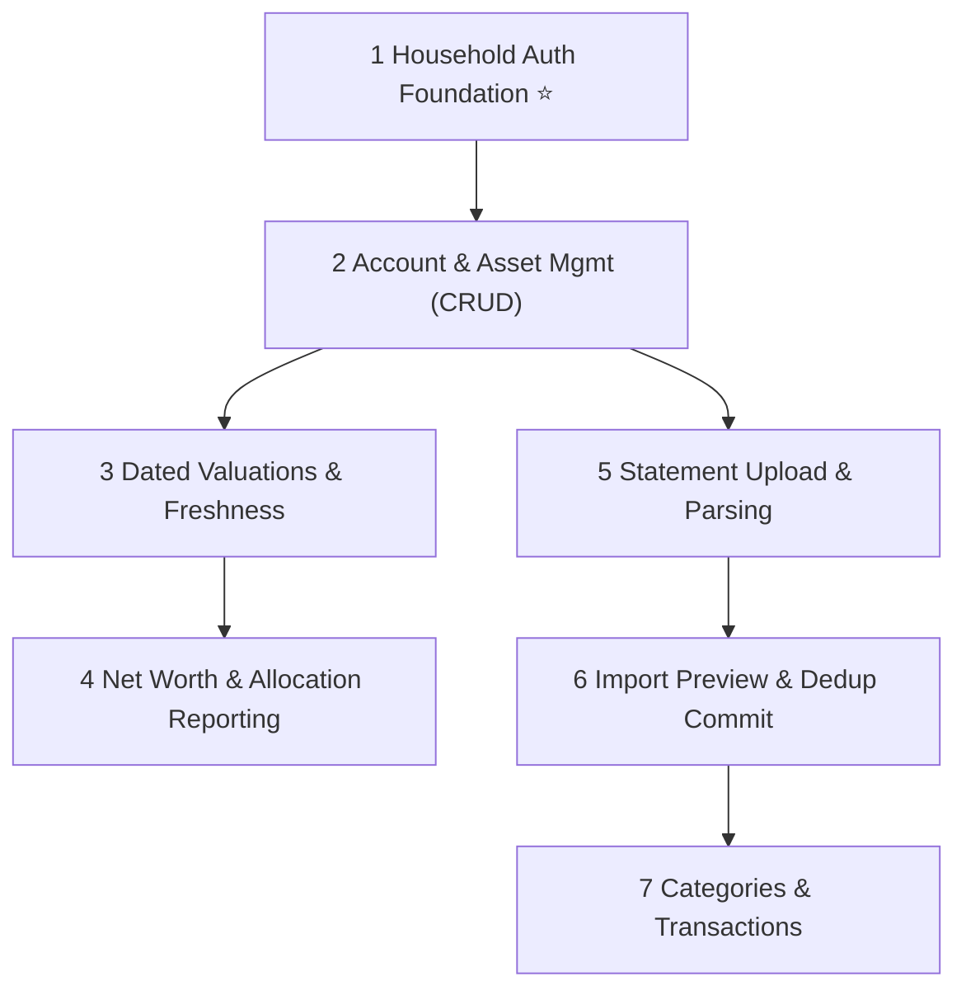

# FinanceTracker — P0 Essential Backlog (Reconciled MVP)

> These are the **must-have** features for a production-ready Minimum Viable Product for a two-user household.
> Items are ordered by architectural dependency and implementation sequence.

---

## 1. Household Security & Authorization Foundation ⭐ *Foundational Slice*

> [!IMPORTANT]
> Authentication and server-side household authorization must precede financial records.
> Every protected operation must enforce access on the server; the frontend is never a security boundary.

**Description:** Provider-independent authentication context and household authorization handler. Establishes user identification, active household tenancy, and role-based / ownership-based access control.

**Acceptance Criteria:**
- [x] Server extracts authenticated user ID and household membership claims from security token / session cookie (`ICurrentUser`, `IHouseholdContext`).
- [x] Requests without valid authentication return `401 Unauthorized` on protected endpoints.
- [x] Requests attempting to access data outside the user's household return `403 Forbidden`.
- [x] Local development and test authentication scheme enables seamless automated and manual testing without external cloud identity provider dependencies.
- [x] ASP.NET Core Identity with secure HttpOnly cookies, account lockout (5 attempts / 15 min), and environment gating (DevAuth completely excluded in Production).

**Layers:** Application · Infrastructure · API · Tests  
**Complexity:** **M**  
**Status:** **Completed & Verified (16 API & Auth Security integration tests)**

---

## 2. Account & Asset Management (CRUD)

**Description:** Manage financial accounts and wealth holdings across all supported asset types (Bank Checking, Savings, Credit Card, Investment, Fixed Deposit, EPF, PPF, NPS, Loan, Other) with explicit Joint or Individual ownership.

**Acceptance Criteria:**
- [x] User can create, view, edit, and soft-deactivate financial accounts.
- [x] Supports all core asset/liability categories: Checking, Savings, CreditCard, Investment, FixedDeposit, Epf, Ppf, Nps, Loan, Other.
- [x] Individual accounts require a valid `OwnerUserId`; Joint accounts are shared across the household.
- [x] Server-side validation enforces 3-letter ISO 4217 currency codes, non-empty names, and tenancy.
- [x] Joint accounts can be modified by any household member; individual accounts can only be modified by their owner or household admin.
- [x] React UI provides responsive account listing, creation/edit modals, ownership badges, and active/inactive filters.

**Layers:** Domain · Application · Infrastructure · API · Web  
**Complexity:** **S**  
**Status:** **Completed & Verified (65 Domain tests + 8 Application tests + 8 API tests)**

---

## 3. Dated Valuations & Asset Freshness

**Description:** Record historical and current dated valuations for accounts and illiquid/retirement assets (e.g. EPF passbook balance, PPF credit, NPS NAV valuation, FD maturity value, bank closing balance).

**Acceptance Criteria:**
- [x] User can record a dated valuation (`ValuationDate`, `Amount`, `CurrencyCode`, `SourceType`, `Notes`, `SourceReference`).
- [x] Valuation amount uses exact decimal arithmetic and enforces currency match with account.
- [x] User can edit valuations with complete audit trail (`UpdatedByUserId`, `UpdatedAt`).
- [x] View valuation history for an account sorted chronologically in UI and API.
- [x] System identifies latest valuation and computes "staleness" (configurable threshold, default >90 days).
- [x] Duplicate-date valuations resolve deterministically using creation timestamp ordering.
- [x] Explain data coverage and valuation dates explicitly in the UI rather than assuming stale figures are current.

**Layers:** Domain · Application · Infrastructure · API · Web  
**Complexity:** **M**  
**Status:** **Completed & Verified (Domain tests + Application tests + API tests)**

---

## 4. Household & Individual Net Worth Reporting

**Description:** Calculate household consolidated net worth and permitted individual net worth breakdowns, categorizing assets vs liabilities and detailing asset allocation.

**Acceptance Criteria:**
- [x] Consolidated household net worth = Total Assets (Joint + Member 1 + Member 2) − Total Liabilities, strictly partitioned per currency (no silent conversion/mixing of currencies).
- [x] Permitted individual net worth = Individual's personal accounts + 50% of joint accounts.
- [x] Asset allocation breakdown per currency (by AccountType).
- [x] Explicitly disclose valuation freshness/date and flag missing or stale valuations for every contributing balance.
- [x] Historical comparison between two dates calculating absolute delta and percentage change per currency.

**Layers:** Domain · Application · API · Web  
**Complexity:** **M**  
**Status:** **Completed, Audited & Verified (116 backend tests + 4 frontend tests; see `docs/reviews/security-financial-readiness.md`)**

---

## 5. Statement Upload & Isolated File Parsing

**Description:** Secure statement upload to private Azure Blob Storage (or isolated local filesystem in development) and isolated, deterministic parsing of financial statement files (CSV in P0-5 slice).

**Acceptance Criteria:**
- [x] Validates MIME type, file extension (`.csv`), file size limit (10 MB), and file content (magic-byte inspection to reject disguised binaries/PE/ELF/PDF/ZIP and null-byte injection).
- [x] File stored securely via `IStatementStorage` (`LocalStorageStatementStorage` for dev, `AzureBlobStatementStorage` with private container and Managed Identity / `DefaultAzureCredential` for Azure).
- [x] Storage keys are cryptographically random GUIDs; raw user filenames are sanitized and stored solely as audit metadata in SQL. No document contents or private blob URLs are stored in SQL or returned to clients.
- [x] Cookie-authenticated state-changing requests protected by `CookieAntiforgeryMiddleware` enforcing `X-XSRF-Token` / `XSRF-TOKEN` cookie exchange (`/api/auth/csrf-token`).
- [x] Isolated parsing pipeline (`ICsvStatementParser` / `CsvStatementParser`) extracts dates, descriptions, amounts, and transaction debit/credit directions via RFC 4180 streaming.
- [x] Malformed records, missing headers, invalid dates/amounts, and ambiguous debit/credit values are captured with 1-based row numbers and safe error messages without failing the request or throwing unhandled exceptions.
- [x] Formula injection protection: strips leading formula trigger characters (`=`, `+`, `-`, `@`, `\t`, `\r`) from transaction descriptions during parsing.
- [x] Complete ledger isolation: parsing does NOT mutate the `Transaction` ledger or persist financial records.
- [x] Atomic failure rollback: database failure immediately deletes newly uploaded blob/local storage object to prevent orphan leaks.
- [x] React UI provides pre-upload client-side validation, 10 MB limit notice, upload progress bar, parse summary table, row-level error breakdown, and explicit disclaimer that no transactions have been imported into the ledger.

**Configuration & Environments:**
- `Storage:Provider`: `"LocalStorage"` (default for `Development`) or `"AzureBlob"` (mandatory for `Production`; enforced at startup).
- `Storage:LocalStorage:BasePath`: default `App_Data/Statements` (path traversal guarded).
- `Storage:AzureBlob:ServiceUri` & `Storage:AzureBlob:ContainerName`: configured via App Service settings with `Storage Blob Data Contributor` RBAC role assigned via Bicep.

**Supported Generic CSV Format:**
- Headers (case-insensitive):
  - Date: `Date`, `Transaction Date`, `Txn Date`, `Posting Date` (supports ISO 8601 `yyyy-MM-dd`, `MM/dd/yyyy`, `dd/MM/yyyy`, `yyyy/MM/dd`).
  - Description: `Description`, `Narrative`, `Payee`, `Details`, `Memo`.
  - Amount: Either a signed single column `Amount` / `Total` (negative = Debit, positive = Credit), OR separate two columns `Debit` (`Withdrawal`, `Out`) and `Credit` (`Deposit`, `In`).
  - Optional direction column: `Type` / `Direction` (`Debit`/`Credit` or `DR`/`CR`).
- Unsupported formats are rejected with a clear message: `"CSV file does not match the supported generic format..."`

**Remaining Limitations & Next Steps:**
- P0-5 only parses CSV files into an in-memory preview summary; OFX/QFX and PDF parsing will follow in subsequent slices.
- Proceed to P0-6: Statement Import Preview, Ambiguity Detection & Dedup Commit (ledger mutation, hash-based deduplication, and staging commit).

**Layers:** Infrastructure (Storage & Migrations) · Importing · Application · API · Web · Tests  
**Complexity:** **M**  
**Status:** **Completed & Verified (150 backend tests + 10 frontend tests)**

---

## 6. Statement Import Preview, Ambiguity Detection & Dedup Commit

**Description:** Two-stage import workflow: persist parsed records as reviewable import batches and staging rows, detect duplicates against both the target account and the batch itself, flag ambiguous rows, allow user reconciliation/exclusion, and execute an explicit, idempotent, atomic ledger commit.

**Acceptance Criteria:**
- [x] Parsing and previewing never mutate the ledger; transactions are only persisted on explicit user confirmation.
- [x] Staged candidate transactions preserve original source row numbers, parsed values, diagnostics, duplicate flags, and user resolutions.
- [x] Canonical SHA-256 fingerprinting detects possible duplicates (`account_id`, `date`, normalized `description`, `amount`, `type`, `currency`).
- [x] Duplicates and errors are flagged for user review and are never silently discarded or committed.
- [x] User can edit row values, approve duplicates as-is, exclude unwanted rows, and select eligible transactions.
- [x] Multi-tab frontend review interface with KPI counters, filter tabs, edit modal, and permanent ledger warning.
- [x] Server-side revalidation of eligibility, household authorization, account ownership, and duplicate state at commit time.
- [x] Atomic EF Core transaction execution committing ledger records and batch status in a single boundary.
- [x] Idempotent commit handling: repeated commit requests safely return committed counts without duplicating ledger rows.

**Amount-Sign Convention & Currency Semantics:**
- `Amount` is strictly non-negative (`decimal(19,4)`).
- `Type` is `TransactionType.Debit` or `TransactionType.Credit`.
- `SignedAmount` follows standard financial accounting: Credits are positive (`+Amount`), Debits are negative (`-Amount`).
- Currencies are determined by the target account's ISO 4217 currency code.
- Imported transactions do not alter `AccountValuation` or account balance entities.

**Status:** **Completed & Verified (177 backend tests + 13 frontend tests)**
**Layers:** Domain · Importing · Application · Infrastructure (Migrations & Repositories) · API · Web · Tests  
**Complexity:** **L**

---

## 7. Categories & Transaction Management

**Description:** Category hierarchy and transaction list view with filtering, search, sorting, and manual transaction entry.

**Acceptance Criteria:**
- [ ] User can create, rename, and organize categories with parent-child relationships.
- [ ] Paginated transaction list with date range, account, and keyword search filters.
- [ ] Single and bulk category assignment for transactions.

**Layers:** Domain · Application · Infrastructure · API · Web  
**Complexity:** **M**

---

## Dependency Graph

