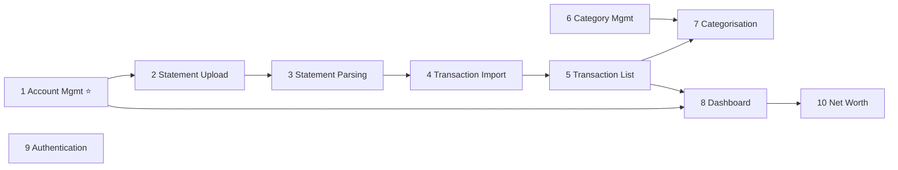

# FinanceTracker — P0 Essential Backlog (MVP)

> These are the **must-have** features for a usable Minimum Viable Product.
> Items are ordered by recommended implementation sequence.

---

## 1. Account Management ⭐ *Recommended First Vertical Slice*

> [!IMPORTANT]
> **Start here.** This feature is the smallest end-to-end slice that exercises every
> layer: React form → API endpoint → Application service → Domain entity →
> EF Core persistence → Azure SQL. It establishes the full-stack pattern, project
> structure, CI pipeline, and coding conventions that all subsequent features will follow.

**Description:** CRUD operations for financial accounts (checking, savings, credit
card, etc.). Users can create, view, edit, and deactivate accounts.

**Acceptance Criteria:**

- [ ] User can create an account with name, type, and currency code.
- [ ] User can view a list of all active accounts.
- [ ] User can edit an account's name and type.
- [ ] User can deactivate an account (soft-deactivate via `IsActive` flag).
- [ ] Server-side validation rejects invalid currency codes and empty names.

**Layers:** Domain · Application · Infrastructure · API · Web

**Complexity:** **S** — Simple CRUD, well-understood pattern.

---

## 2. Statement Upload

**Description:** Upload CSV, OFX, or PDF bank statement files. Files are validated
(type, size) and stored in private Azure Blob Storage for later parsing.

**Acceptance Criteria:**

- [ ] User can upload a file via the web UI.
- [ ] Only `.csv`, `.ofx`, and `.pdf` files are accepted; others are rejected with a clear error.
- [ ] Files larger than 10 MB are rejected.
- [ ] Uploaded file is stored in a private blob container and an `Import` record is created with status `Pending`.
- [ ] Original file name is preserved in metadata.

**Layers:** Application · Infrastructure (Blob Storage) · API · Web

**Complexity:** **M** — File upload plumbing, blob integration, validation pipeline.

---

## 3. Statement Parsing

**Description:** Parse uploaded statement files into raw transaction rows. Start
with CSV; add OFX and PDF support later.

**Acceptance Criteria:**

- [ ] CSV parser extracts date, description, amount, and transaction type from uploaded files.
- [ ] Parser handles common CSV variants (different delimiters, header rows, date formats).
- [ ] Malformed rows are logged and skipped without aborting the entire import.
- [ ] Import status transitions from `Pending` → `Processing` → `Completed` or `Failed`.

**Layers:** Importing · Application · Domain

**Complexity:** **M** — Parsing logic, error handling, format flexibility.

---

## 4. Transaction Import

**Description:** Persist parsed transaction rows into the database with
content-hash-based deduplication.

**Acceptance Criteria:**

- [ ] Each parsed row is hashed using SHA-256 of `(AccountId + Date + Description + Amount + CurrencyCode)`.
- [ ] Rows with a hash that already exists for the same account are skipped and counted as duplicates.
- [ ] `Import.RecordCount` and `Import.DuplicateCount` are updated accurately.
- [ ] Re-uploading the same file produces zero new transactions.

**Layers:** Importing · Application · Infrastructure · Domain

**Complexity:** **M** — Deduplication logic, hash generation, batch insert.

---

## 5. Transaction List

**Description:** View imported and manually entered transactions with filtering,
sorting, and pagination.

**Acceptance Criteria:**

- [ ] User can view a paginated list of transactions for a selected account.
- [ ] User can filter transactions by date range.
- [ ] User can search transactions by description text.
- [ ] List displays date, description, amount, type (debit/credit), and category.
- [ ] Default sort is by date descending.

**Layers:** Application · Infrastructure · API · Web

**Complexity:** **M** — Pagination, filtering, search query building.

---

## 6. Category Management

**Description:** CRUD for transaction categories with optional parent-child
hierarchy (e.g. "Food" → "Groceries", "Dining Out").

**Acceptance Criteria:**

- [ ] User can create a top-level category (e.g. "Housing").
- [ ] User can create a sub-category under a parent (e.g. "Housing" → "Rent").
- [ ] User can rename or delete a category.
- [ ] Deleting a parent category prompts for handling of child categories.
- [ ] Category names are unique within the same parent.

**Layers:** Domain · Application · Infrastructure · API · Web

**Complexity:** **S** — Simple CRUD with one self-referential FK.

---

## 7. Transaction Categorisation

**Description:** Assign categories to transactions. Start with manual assignment;
auto-categorisation (rules, ML) is a future enhancement.

**Acceptance Criteria:**

- [ ] User can assign a category to a single transaction.
- [ ] User can bulk-assign a category to multiple selected transactions.
- [ ] User can remove a category assignment.
- [ ] Categorised transactions display their category in the transaction list.

**Layers:** Application · Infrastructure · API · Web

**Complexity:** **S** — Update operation on existing transactions.

---

## 8. Dashboard

**Description:** Summary view showing account balances, recent transactions, and
basic spending overview.

**Acceptance Criteria:**

- [ ] Dashboard displays all active accounts with their current balances.
- [ ] Dashboard shows the 10 most recent transactions across all accounts.
- [ ] Dashboard shows total assets, total liabilities, and net worth.
- [ ] Data refreshes when the user navigates to the dashboard.

**Layers:** Application · Infrastructure · API · Web

**Complexity:** **M** — Aggregation queries, multiple data sources, UI layout.

---

## 9. User Authentication

**Description:** Login and logout using ASP.NET Core Identity. Registration may be
seed-only (no open registration for a household app).

**Acceptance Criteria:**

- [ ] User can log in with email and password.
- [ ] User can log out; session is terminated.
- [ ] Unauthenticated requests to protected endpoints return `401`.
- [ ] Failed login attempts are rate-limited (lockout after 5 attempts).
- [ ] Registration is either admin-seeded or behind an invite code (no open sign-up).

**Layers:** Infrastructure (Identity) · API · Web

**Complexity:** **M** — Identity setup, cookie/JWT configuration, login UI.

---

## 10. Net Worth Calculation

**Description:** Calculate net worth as total assets minus total liabilities,
aggregated across all active accounts.

**Acceptance Criteria:**

- [ ] Assets = sum of balances in Checking, Savings, and Investment accounts.
- [ ] Liabilities = sum of balances in CreditCard and Loan accounts.
- [ ] Net worth = Assets − Liabilities.
- [ ] Calculation uses the `Money` value object and respects currency codes.
- [ ] Displayed on the dashboard (integrates with item 8).

**Layers:** Domain · Application · API · Web

**Complexity:** **S** — Aggregation query, value object arithmetic.

---

## Summary

| # | Feature | Complexity | Key Dependency |
|---|---|---|---|
| 1 | Account Management ⭐ | S | — (first slice) |
| 2 | Statement Upload | M | Account Management |
| 3 | Statement Parsing | M | Statement Upload |
| 4 | Transaction Import | M | Statement Parsing |
| 5 | Transaction List | M | Transaction Import |
| 6 | Category Management | S | — (parallel track) |
| 7 | Transaction Categorisation | S | Transaction List, Category Management |
| 8 | Dashboard | M | Account Management, Transaction List |
| 9 | User Authentication | M | — (can slot in at any point) |
| 10 | Net Worth Calculation | S | Dashboard, Account Management |

