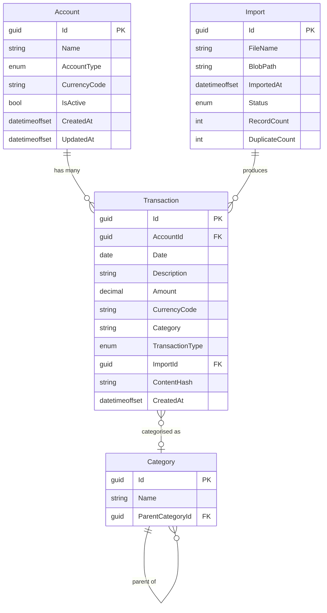

# FinanceTracker — Data Model

> [!NOTE]
> This document describes the **conceptual data model**. Full EF Core entity
> configurations will be added as each feature is implemented.
> All example data below is **synthetic** — no real financial information is used.

---

## 1. Money Value Object

All monetary values are represented by a `Money` value object in the Domain layer.

| Property | Type | Description |
|---|---|---|
| `Amount` | `decimal` | The monetary amount. |
| `CurrencyCode` | `string` (3 chars) | ISO 4217 currency code (e.g. `USD`, `EUR`, `GBP`). |

### Rules

- **SQL precision:** `decimal(19,4)` — supports values up to ±999,999,999,999,999.9999.
- **Rounding:** Banker's rounding (`MidpointRounding.ToEven`) is applied whenever arithmetic produces more than 4 decimal places.
- **Equality:** Two `Money` instances are equal only if both `Amount` and `CurrencyCode` match.
- **Arithmetic:** Operations between different currencies throw an exception (no implicit conversion).

### Example

```csharp
var grocery = new Money(42.50m, "USD");   // Acme Groceries
var coffee  = new Money(5.75m, "USD");    // Morning Brew Coffee
var total   = grocery + coffee;           // Money(48.25, "USD")
```

---

## 2. Core Entities

### 2.1 Account

Represents a financial account (bank account, credit card, investment, etc.).

| Column | Type | Constraints | Description |
|---|---|---|---|
| `Id` | `Guid` | PK | Unique identifier. |
| `Name` | `string` | Required, max 200 | Display name (e.g. "Main Checking"). |
| `AccountType` | `enum` | Required | See `AccountType` enum below. |
| `CurrencyCode` | `string(3)` | Required | ISO 4217 code for the account's currency. |
| `IsActive` | `bool` | Default `true` | Soft-active flag; inactive accounts are hidden from default views. |
| `CreatedAt` | `DateTimeOffset` | Required, UTC | Record creation timestamp. |
| `UpdatedAt` | `DateTimeOffset` | Required, UTC | Last modification timestamp. |

**`AccountType` enum:**

| Value | Description |
|---|---|
| `Checking` | Current / checking account |
| `Savings` | Savings account |
| `CreditCard` | Credit card |
| `Investment` | Brokerage / investment account |
| `Loan` | Mortgage, personal loan, etc. |
| `Other` | Catch-all for unlisted types |

### 2.2 Transaction

A single financial transaction associated with an account.

| Column | Type | Constraints | Description |
|---|---|---|---|
| `Id` | `Guid` | PK | Unique identifier. |
| `AccountId` | `Guid` | FK → Account, Required | Owning account. |
| `Date` | `DateOnly` | Required | Transaction date. |
| `Description` | `string` | Required, max 500 | Merchant/payee description (e.g. "Acme Groceries"). |
| `Amount` | `decimal(19,4)` | Required | Transaction amount (always positive; direction indicated by `TransactionType`). |
| `CurrencyCode` | `string(3)` | Required | ISO 4217 currency of the transaction. |
| `Category` | `string` | Nullable, max 200 | Optional category label (denormalised for simplicity; linked via `CategoryId` later). |
| `TransactionType` | `enum` | Required | `Debit` or `Credit`. |
| `ImportId` | `Guid` | FK → Import, Nullable | The import batch that created this transaction (null if entered manually). |
| `ContentHash` | `string(64)` | Required, Unique per Account | SHA-256 hex digest for deduplication. |
| `CreatedAt` | `DateTimeOffset` | Required, UTC | Record creation timestamp. |

**`TransactionType` enum:**

| Value | Description |
|---|---|
| `Debit` | Money going out (expense, payment) |
| `Credit` | Money coming in (income, refund) |

### 2.3 Import

Represents a single statement file upload and its processing result.

| Column | Type | Constraints | Description |
|---|---|---|---|
| `Id` | `Guid` | PK | Unique identifier. |
| `FileName` | `string` | Required, max 500 | Original file name as uploaded (e.g. "statement-2025-05.csv"). |
| `BlobPath` | `string` | Required, max 1000 | Path within the private blob container. |
| `ImportedAt` | `DateTimeOffset` | Required, UTC | When the upload occurred. |
| `Status` | `enum` | Required | See `ImportStatus` enum below. |
| `RecordCount` | `int` | Default 0 | Total rows parsed from the file. |
| `DuplicateCount` | `int` | Default 0 | Rows skipped due to duplicate `ContentHash`. |

**`ImportStatus` enum:**

| Value | Description |
|---|---|
| `Pending` | File uploaded, not yet processed. |
| `Processing` | Parser is actively reading the file. |
| `Completed` | All rows processed successfully. |
| `Failed` | Processing encountered a fatal error. |

### 2.4 Category

Hierarchical transaction category.

| Column | Type | Constraints | Description |
|---|---|---|---|
| `Id` | `Guid` | PK | Unique identifier. |
| `Name` | `string` | Required, max 200 | Category name (e.g. "Groceries", "Dining Out"). |
| `ParentCategoryId` | `Guid` | FK → Category, Nullable | Parent category for hierarchy (null = top-level). |

---

## 3. Entity-Relationship Diagram



---

## 4. Import Deduplication Strategy

Each imported transaction row is fingerprinted with a **SHA-256 hash** of its
normalised content:

```
ContentHash = SHA256( AccountId + "|" + Date + "|" + Description + "|" + Amount + "|" + CurrencyCode )
```

### Example

| Field | Value |
|---|---|
| AccountId | `b7e2c3a1-...` |
| Date | `2025-05-15` |
| Description | `Acme Groceries` |
| Amount | `42.5000` |
| CurrencyCode | `USD` |
| **ContentHash** | `a3f1b9c2d4e5...` (64 hex chars) |

### Rules

1. `ContentHash` is unique **per account** (`UNIQUE (AccountId, ContentHash)`).
2. If a row's hash already exists for the same account, it is counted as a
   duplicate and skipped.
3. The original uploaded file is always preserved in blob storage regardless of
   duplicate count.

> [!WARNING]
> Two genuinely distinct transactions with identical date, description, amount, and
> currency on the same account **will be treated as duplicates**. A future iteration
> may add a row-sequence counter to the hash inputs.

---

## 5. Currency Handling

- Every `Account` declares a `CurrencyCode`.
- Every `Transaction` stores its own `CurrencyCode` (which should match the
  account's currency in the initial version).
- **Single-currency households** are the initial target. Multi-currency support
  (exchange rates, conversion, reporting currency) is deferred.
- ISO 4217 codes are validated on input.

---

## 6. Audit Fields & Soft Delete

| Convention | Detail |
|---|---|
| `CreatedAt` | Set once on insert; never modified. UTC `DateTimeOffset`. |
| `UpdatedAt` | Updated on every modification. UTC `DateTimeOffset`. Present on entities that support updates (e.g. `Account`). |
| **Soft delete** | Under consideration. `Account.IsActive = false` provides soft-active semantics. Full soft-delete (an `IsDeleted` flag or `DeletedAt` timestamp) may be added when the deletion UX is implemented. |

---

## 7. EF Core Conventions

| Convention | Detail |
|---|---|
| Table naming | `snake_case` (e.g. `accounts`, `transactions`). |
| Column naming | `snake_case` (e.g. `account_type`, `currency_code`). |
| Timestamps | All date/time columns use `DateTimeOffset` stored in UTC. |
| Primary keys | `Guid` generated client-side (`Guid.NewGuid()`). |
| String lengths | Explicitly configured via `HasMaxLength()`. |
| Decimal precision | Configured via `HasPrecision(19, 4)` for all monetary columns. |
| Enums | Stored as `string` (not `int`) for readability and forward compatibility. |

### Example Convention Configuration (Pseudocode)

```csharp
modelBuilder.Entity<Transaction>(e =>
{
    e.ToTable("transactions");
    e.Property(t => t.Amount).HasPrecision(19, 4);
    e.Property(t => t.CurrencyCode).HasMaxLength(3);
    e.Property(t => t.ContentHash).HasMaxLength(64);
    e.Property(t => t.TransactionType).HasConversion<string>();
    e.HasIndex(t => new { t.AccountId, t.ContentHash }).IsUnique();
});
```
