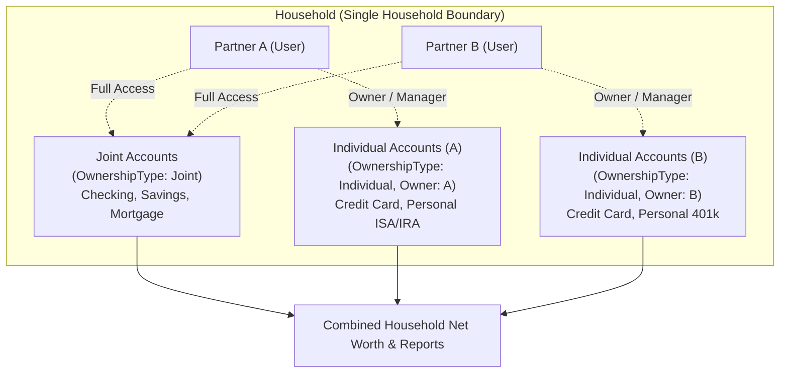
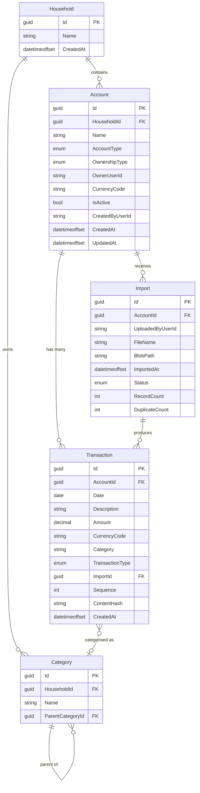

# FinanceTracker — Data Model

> [!NOTE]
> This document describes the **conceptual data model**. Full EF Core entity
> configurations will be added as each feature is implemented.
> All example data below is **synthetic** — no real financial information is used.

---

## 1. Money Value Object

All monetary values are represented by a `Money` value object in the Domain layer.

| Property | Type | Description |
|---|---|---|
| `Amount` | `decimal` | The monetary amount. |
| `CurrencyCode` | `string` (3 chars) | ISO 4217 currency code (e.g. `USD`, `EUR`, `GBP`). |

### Rules

- **SQL precision:** `decimal(19,4)` — supports values up to ±999,999,999,999,999.9999.
- **Rounding:** Banker's rounding (`MidpointRounding.ToEven`) is applied whenever arithmetic produces more than 4 decimal places.
- **Equality:** Two `Money` instances are equal only if both `Amount` and `CurrencyCode` match.
- **Arithmetic:** Operations between different currencies throw an exception (no implicit conversion).

### Investment Unit Decision Note

`Money` represents currency amounts (cash, transaction values, account balances) with 2 to 4 decimal places matching SQL `decimal(19,4)`. It is intentionally **not** used to represent investment share quantities (e.g., fractional stock shares or crypto holdings requiring 6–8 decimal places). A dedicated `HoldingQuantity` / `UnitQuantity` value object will be introduced when the investment portfolio slice is implemented.

### Example

```csharp
var grocery = new Money(42.50m, "USD");   // Acme Groceries
var coffee  = new Money(5.75m, "USD");    // Morning Brew Coffee
var total   = grocery + coffee;           // Money(48.25, "USD")
```

---

## 2. Household Ownership Model & Core Entities

### 2.0 Household Ownership Model

To support private household finances with up to two authorized users (e.g., Partner A and Partner B), the data model introduces an explicit household boundary with flexible account ownership:



#### Ownership Scope (`OwnershipType`)

| Ownership Type | Description | Visibility & Access |
|---|---|---|
| `Joint` (Default) | Co-owned by both household partners. | Both partners have full access to view, edit, import statements, and manage transactions. |
| `Individual` | Legally or operationally owned by one partner (`OwnerUserId`). | Owned and managed by that partner; included in aggregated household net worth views with filterable reporting. |

#### Auditability & Provenance

To preserve clear audit trails without complexity:
- Every `Account` records `CreatedByUserId`, `UpdatedByUserId`, and nullable `OwnerUserId` (required when `OwnershipType == Individual`).
- Every `Import` records `UploadedByUserId` to identify which partner uploaded the bank statement.
- Every `Transaction` links to its source `ImportId` (inheriting file provenance and upload user) or tracks manual creation.

#### Reporting Views

1. **Combined Household (Default)**: Aggregates all Joint + Individual A + Individual B accounts to present true total household net worth, assets, and liabilities.
2. **Individual Breakdown**: Filters balances and cash flows by partner or ownership type (`Joint vs Individual`).

---

### 2.1 Household

The top-level boundary for the household instance.

| Column | Type | Constraints | Description |
|---|---|---|---|
| `Id` | `Guid` | PK | Unique identifier. |
| `Name` | `string` | Required, max 200 | Display name (e.g., "Household"). |
| `CreatedAt` | `DateTimeOffset` | Required, UTC | Record creation timestamp. |

### 2.1.1 HouseholdMember

Associates an authenticated user with a household and their permission role.

| Column | Type | Constraints | Description |
|---|---|---|---|
| `HouseholdId` | `Guid` | PK, FK → Household | Associated household. |
| `UserId` | `string` | PK, max 450 | ASP.NET Core Identity user ID. |
| `Role` | `enum` | Required | `HouseholdRole` (`Admin`, `Member`). Stored as string. |
| `JoinedAt` | `DateTimeOffset` | Required, UTC | Timestamp when the member joined the household. |

### 2.2 Account

Represents a financial account (bank account, credit card, investment, loan, etc.).

| Column | Type | Constraints | Description |
|---|---|---|---|
| `Id` | `Guid` | PK | Unique identifier. |
| `HouseholdId` | `Guid` | FK → Household, Required | Owning household boundary. |
| `Name` | `string` | Required, max 200 | Display name (e.g. "Main Joint Checking", "Sam's Roth IRA"). |
| `AccountType` | `enum` | Required | See `AccountType` enum below. |
| `OwnershipType` | `enum` | Required | `Joint` (0) or `Individual` (1). |
| `OwnerUserId` | `string` | Nullable, max 450 | ASP.NET Identity User ID of owner (required if `OwnershipType == Individual`). |
| `CurrencyCode` | `string(3)` | Required | ISO 4217 code for the account's currency (uppercase ASCII). |
| `IsActive` | `bool` | Default `true` | Soft-active flag; inactive accounts are hidden from default views. |
| `CreatedByUserId` | `string` | Required, max 450 | User ID who created the account. |
| `CreatedAt` | `DateTimeOffset` | Required, UTC | Record creation timestamp. |
| `UpdatedAt` | `DateTimeOffset` | Required, UTC | Last modification timestamp. |

**`AccountType` enum:**
`Checking`, `Savings`, `CreditCard`, `Investment`, `Loan`, `Other`.

**`OwnershipType` enum:**
`Joint` (shared household asset/liability), `Individual` (personal asset/liability).

### 2.3 Transaction

A single financial transaction associated with an account.

| Column | Type | Constraints | Description |
|---|---|---|---|
| `Id` | `Guid` | PK | Unique identifier. |
| `AccountId` | `Guid` | FK → Account, Required | Owning account. |
| `Date` | `DateOnly` | Required | Transaction date. |
| `Description` | `string` | Required, max 500 | Merchant/payee description (e.g. "Acme Groceries"). |
| `Amount` | `decimal(19,4)` | Required | Transaction amount (always positive; direction indicated by `TransactionType`). |
| `CurrencyCode` | `string(3)` | Required | ISO 4217 currency of the transaction. |
| `Category` | `string` | Nullable, max 200 | Optional category label. |
| `TransactionType` | `enum` | Required | `Debit` or `Credit`. |
| `ImportId` | `Guid` | FK → Import, Nullable | The import batch that created this transaction (null if entered manually). |
| `Sequence` | `int` | Default 0 | Row order/sequence index within same-day transactions to disambiguate identical purchases. |
| `ContentHash` | `string(64)` | Required, Unique per Account | SHA-256 hex digest for deduplication. |
| `CreatedAt` | `DateTimeOffset` | Required, UTC | Record creation timestamp. |

### 2.4 Import

Represents a single statement file upload and its processing result.

| Column | Type | Constraints | Description |
|---|---|---|---|
| `Id` | `Guid` | PK | Unique identifier. |
| `AccountId` | `Guid` | FK → Account, Required | Target account for the statement import. |
| `UploadedByUserId` | `string` | Required, max 450 | User ID of the partner who uploaded the statement. |
| `FileName` | `string` | Required, max 500 | Original file name as uploaded (e.g. "statement-2025-05.csv"). |
| `BlobPath` | `string` | Required, max 1000 | Path within the private blob container. |
| `ImportedAt` | `DateTimeOffset` | Required, UTC | When the upload occurred. |
| `Status` | `enum` | Required | See `ImportStatus` enum (`Pending`, `Processing`, `Completed`, `Failed`). |
| `RecordCount` | `int` | Default 0 | Total rows parsed from the file. |
| `DuplicateCount` | `int` | Default 0 | Rows skipped due to duplicate `ContentHash`. |

### 2.5 Category

Hierarchical transaction category.

| Column | Type | Constraints | Description |
|---|---|---|---|
| `Id` | `Guid` | PK | Unique identifier. |
| `HouseholdId` | `Guid` | FK → Household, Required | Household owning the category hierarchy. |
| `Name` | `string` | Required, max 200 | Category name (e.g. "Groceries", "Dining Out"). |
| `ParentCategoryId` | `Guid` | FK → Category, Nullable | Parent category for hierarchy (null = top-level). |

---

## 3. Entity-Relationship Diagram



---

## 4. Import Deduplication Strategy

Each imported transaction row is fingerprinted with a **SHA-256 hash** of its
normalised content:

```
ContentHash = SHA256( AccountId + "|" + Date + "|" + Description + "|" + Amount + "|" + CurrencyCode + "|" + Sequence )
```

### Example

| Field | Value |
|---|---|
| AccountId | `b7e2c3a1-...` |
| Date | `2025-05-15` |
| Description | `Acme Groceries` |
| Amount | `42.5000` |
| CurrencyCode | `USD` |
| Sequence | `0` |
| **ContentHash** | `a3f1b9c2d4e5...` (64 hex chars) |

### Rules

1. `ContentHash` is unique **per account** (`UNIQUE (AccountId, ContentHash)`).
2. During statement parsing, multiple transactions with identical Date, Description, Amount, and Currency within the same statement file receive incrementing `Sequence` values (`0, 1, 2, ...`). This disambiguates distinct purchases on the same day while keeping statement re-imports idempotent.
3. If a row's hash already exists for the same account, it is counted as a duplicate and skipped.
4. The original uploaded file is always preserved in blob storage regardless of duplicate count.

---

## 5. Currency Handling

- Every `Account` declares a `CurrencyCode`.
- Every `Transaction` stores its own `CurrencyCode` (which should match the
  account's currency in the initial version).
- **Single-currency households** are the initial target. Multi-currency support
  (exchange rates, conversion, reporting currency) is deferred.
- ISO 4217 codes are validated on input.

---

## 6. Audit Fields & Soft Delete

| Convention | Detail |
|---|---|
| `CreatedAt` | Set once on insert; never modified. UTC `DateTimeOffset`. |
| `UpdatedAt` | Updated on every modification. UTC `DateTimeOffset`. Present on entities that support updates (e.g. `Account`). |
| **Soft delete** | Under consideration. `Account.IsActive = false` provides soft-active semantics. Full soft-delete (an `IsDeleted` flag or `DeletedAt` timestamp) may be added when the deletion UX is implemented. |

---

## 7. EF Core Conventions

| Convention | Detail |
|---|---|
| Table naming | `snake_case` (e.g. `accounts`, `transactions`). |
| Column naming | `snake_case` (e.g. `account_type`, `currency_code`). |
| Timestamps | All date/time columns use `DateTimeOffset` stored in UTC. |
| Primary keys | `Guid` generated client-side (`Guid.NewGuid()`). |
| String lengths | Explicitly configured via `HasMaxLength()`. |
| Decimal precision | Configured via `HasPrecision(19, 4)` for all monetary columns. |
| Enums | Stored as `string` (not `int`) for readability and forward compatibility. |

### Example Convention Configuration (Pseudocode)

```csharp
modelBuilder.Entity<Transaction>(e =>
{
    e.ToTable("transactions");
    e.Property(t => t.Amount).HasPrecision(19, 4);
    e.Property(t => t.CurrencyCode).HasMaxLength(3);
    e.Property(t => t.ContentHash).HasMaxLength(64);
    e.Property(t => t.TransactionType).HasConversion<string>();
    e.HasIndex(t => new { t.AccountId, t.ContentHash }).IsUnique();
});
```
