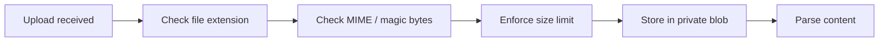

# FinanceTracker — Security Model

> [!IMPORTANT]
> This document defines security boundaries and practices for FinanceTracker. All contributors
> must follow these rules. Violations should be caught in code review and CI checks.

---

## 1. Authentication

### Strategy

FinanceTracker uses **ASP.NET Core Identity** with the built-in EF Core user store
(see [ADR-004](architecture.md#adr-004-authentication-strategy)).

| Scenario | Mechanism |
|---|---|
| SPA (React app) | Cookie authentication with `SameSite=Strict`, `HttpOnly`, `Secure`. |
| API-only / tooling | JWT bearer tokens (optional, for headless clients). |

### Session Rules

- Cookie lifetime: sliding expiration, 30-minute idle timeout.
- Anti-forgery tokens required on all mutating endpoints when using cookie auth.
- Account lockout after 5 consecutive failed login attempts (configurable).

---

## 2. Authorization

| Rule | Detail |
|---|---|
| **Default policy** | All API endpoints require authentication (`[Authorize]` applied globally via policy or filter). |
| **Exceptions** | Only health-check (`/healthz`) and login/register endpoints are marked `[AllowAnonymous]`. |
| **Role-based access** | Not required at MVP (household scale, 1-3 users). Can be layered on later. |

> [!TIP]
> Apply `[Authorize]` as a global filter in `Program.cs` rather than decorating every
> controller. This makes the secure-by-default posture explicit and prevents accidental
> omissions.

---

## 3. File Upload Security

Uploaded bank statements are the primary attack vector. All uploads pass through
multiple validation stages before processing.

### Validation Pipeline



| Check | Rule |
|---|---|
| **Allowed extensions** | `.csv`, `.ofx`, `.pdf` (initially). Reject all others. |
| **MIME / magic bytes** | Validate that the file content matches the declared extension. |
| **Max file size** | 10 MB per upload. Reject larger files at the middleware level. |
| **Content scanning** | Parse and validate structure before persisting transactions. Malformed files are marked `Failed` and preserved for debugging. |
| **File name sanitisation** | Strip path separators and special characters from the original file name before storing metadata. |

---

## 4. Blob Storage Access

See [ADR-005](architecture.md#adr-005-blob-storage-access).

| Rule | Detail |
|---|---|
| **Container access level** | `Private` — no public or anonymous access. |
| **No SAS URLs to clients** | The API proxies all blob reads. End users never receive a direct blob URL. |
| **Authentication to Azure** | **Managed identity** in production; connection string / `DefaultAzureCredential` in development. |
| **Container organisation** | One container per data class (e.g. `statements` for uploaded files). |

> [!CAUTION]
> Never change a container's access level to `Blob` or `Container`. Uploaded bank
> statements contain sensitive financial data and must remain private.

---

## 5. Sensitive Data Handling

### What Is Sensitive

- Account numbers (full or partial)
- Account balances
- Transaction amounts and descriptions
- Statement file contents
- User credentials and tokens

### Rules

| Area | Rule |
|---|---|
| **Logging** | Never log sensitive fields. Use structured logging with explicit allow-lists, not block-lists. |
| **Error messages** | Redact any financial data before returning errors to the client. Return generic messages for unexpected exceptions. |
| **Telemetry** | If Application Insights or similar is added, configure PII scrubbing filters. |
| **Database queries** | Avoid `SELECT *` in logs; use parameterised queries (EF Core default). |

### Example: What NOT To Log

```
❌  logger.LogError("Failed to import transaction: {Amount} at {Merchant}", amount, merchant);
✅  logger.LogError("Failed to import transaction at row {RowIndex} in import {ImportId}", rowIndex, importId);
```

---

## 6. Input Validation

| Layer | Responsibility |
|---|---|
| **Client (React)** | Basic form validation for UX feedback. **Not a security boundary.** |
| **Server (API)** | Authoritative validation on every endpoint. All inputs are validated and sanitised server-side. |
| **Domain** | Invariant enforcement in entities and value objects (e.g. `Money` rejects negative amounts if the domain requires it). |

### Key Rules

- Validate string lengths, numeric ranges, and enum values on all DTOs.
- Reject unexpected properties (do not use `[JsonExtensionData]` on input DTOs).
- Use `FluentValidation` or `DataAnnotations` — be consistent across the project.

---

## 7. CORS

| Environment | Allowed Origins |
|---|---|
| Development | `https://localhost:<port>` (Vite dev server) |
| Production | The exact production domain only |

- No wildcard (`*`) origins.
- Restrict allowed methods to those the API actually uses (`GET`, `POST`, `PUT`, `DELETE`).
- Restrict allowed headers to the minimum required set.

---

## 8. HTTPS

| Environment | Rule |
|---|---|
| Development | HTTPS via dev certificate (`dotnet dev-certs`). |
| Production | HTTPS enforced. Redirect all HTTP → HTTPS. HSTS header enabled with a minimum `max-age` of 1 year. |

---

## 9. Secrets Management

> [!CAUTION]
> **No secrets in source code, `appsettings.json`, or CI workflow files.** Secrets
> checked into the repository — even temporarily — must be considered compromised and
> rotated immediately.

### By Environment

| Environment | Mechanism |
|---|---|
| **Local development** | `dotnet user-secrets` or environment variables. |
| **CI/CD (GitHub Actions)** | OIDC federation with Azure (no stored credentials). GitHub Actions secrets for non-Azure values. |
| **Production (Azure)** | Managed identity for Azure services (SQL, Blob Storage, Key Vault). Key Vault references in App Service configuration for third-party secrets. |

### Key Vault Usage

- Application reads secrets via **Key Vault references** in App Service configuration,
  not by calling the Key Vault API directly.
- Key Vault access is granted through managed identity — no client secrets.
- Secret rotation should not require application redeployment.

---

## 10. Development vs. Production Summary

| Concern | Development | Production |
|---|---|---|
| Authentication | Cookie auth with local Identity DB | Same, with hardened cookie settings |
| Blob access | `DefaultAzureCredential` / Azurite emulator | Managed identity |
| Database | Local SQL Server or Azure SQL dev | Azure SQL with firewall rules |
| HTTPS | Dev certificate | Enforced, HSTS enabled |
| Secrets | `user-secrets` / env vars | Managed identity + Key Vault |
| CORS | `localhost` | Production domain only |
| Logging | Verbose, console | Structured, redacted, Application Insights |
